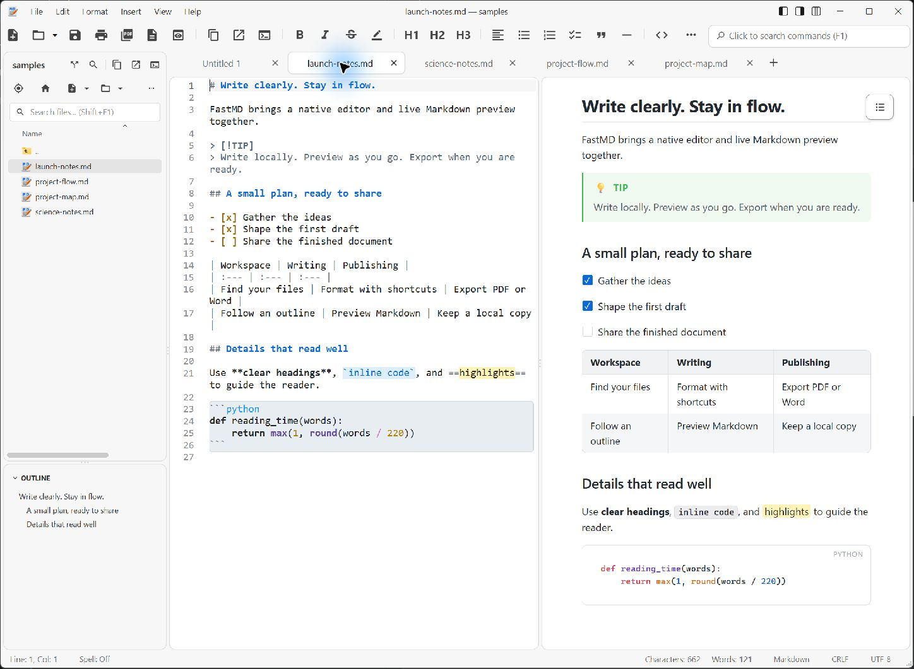
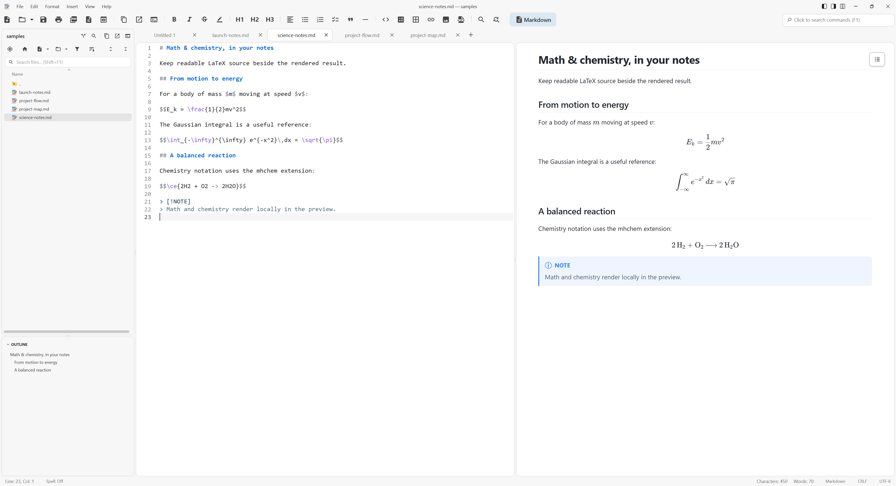
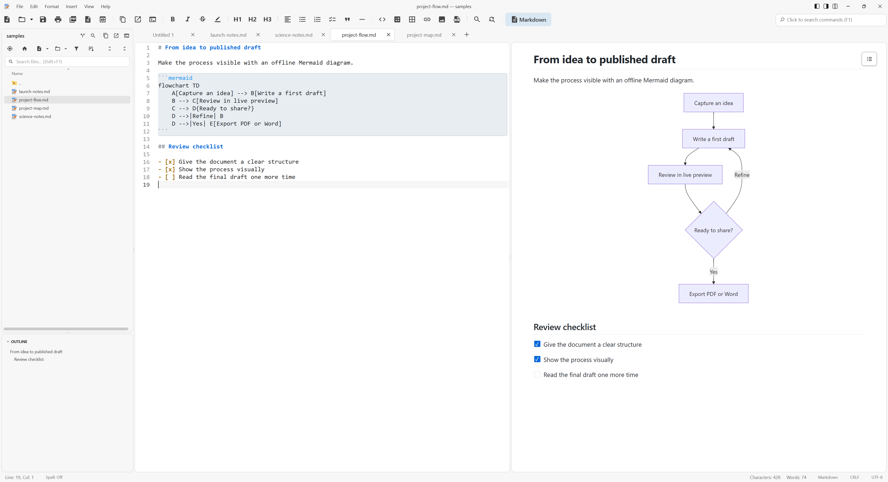
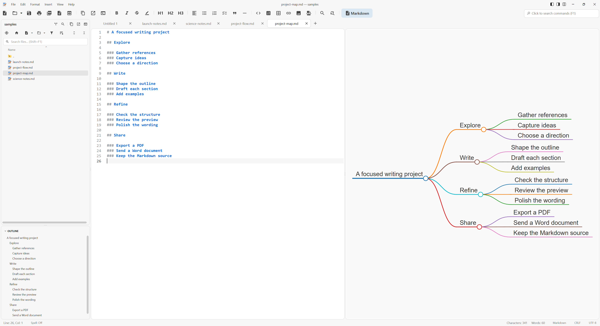
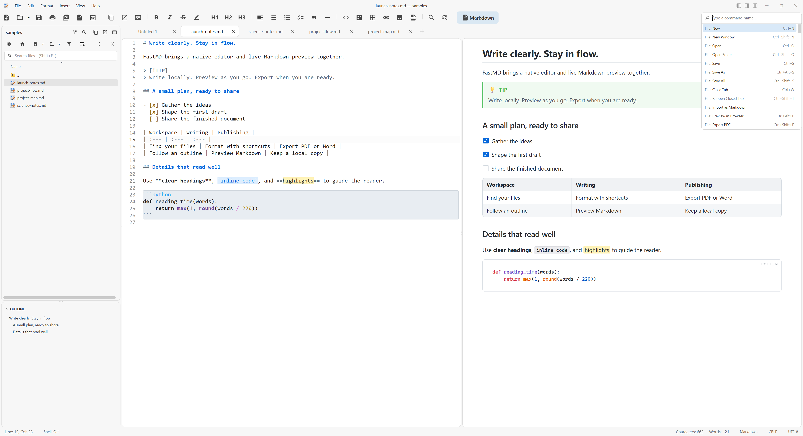

# FastMD

**A native Markdown and text editor for Windows.** Write in a focused editor,
see a live preview, and export documents without sending them to a cloud converter.

[Get FastMD from Microsoft Store](https://apps.microsoft.com/detail/9N4DSD4WNZ9D) ·
[Download Store installer](https://github.com/skypediacode/fastmd/releases/download/store-installer/FastMD.Installer.exe) ·
[Website](https://skypediacode.github.io/fastmd/) ·
[Screenshots](https://skypediacode.github.io/fastmd/screenshots.html)



## Install and update

Microsoft Store is the primary installation and automatic update channel.
The small **FastMD.Installer.exe** download is a permanent Store launcher: it
installs the version currently available to your account and device through
Microsoft Store. Store access is required; it is not an offline application installer.

Future GitHub version releases may contain release notes, without new Portable,
MSI, or standalone EXE packages. Existing repository binaries and historical
releases are legacy files and are no longer refreshed. See [release information](RELEASES.md).

## Write, preview, and share

- **Markdown and code:** syntax highlighting, tabs, a document outline, tables,
  task lists, callouts, footnotes, and a searchable command palette (`F1`).
- **Live preview:** rendered Markdown beside your source, synchronized scrolling,
  and double-click navigation from preview text to its source line.
- **Math and chemistry:** LaTeX rendered with KaTeX, `mhchem` reactions, and visual
  symbol toolbars for inserting notation.
- **Diagrams and mind maps:** offline Mermaid diagrams and an interactive mind
  map (`F10`) built from your document's headings.
- **Workspace:** file navigation, search, and Source Control in the Workspace
  panel. Git operations stay outside the editor typing path.
- **Export:** PDF with heading bookmarks, Word, HTML, EPUB, RTF, OpenDocument,
  LaTeX, and plain text. Local viewers open images, SVG, PDF, and HTML in tabs.

| Math and chemistry | Mermaid diagrams |
| --- | --- |
|  |  |

| Interactive mind map | Command palette |
| --- | --- |
|  |  |

[View full-size screenshots and capture details](https://skypediacode.github.io/fastmd/screenshots.html).
All five images are real captures of FastMD 3.7.0 on Windows, using the
[public demo documents](screenshots/samples). No UI has been generated or composited.

## Native by design

FastMD uses C++20 and Qt 6 Widgets. The editor and application UI are native;
the Markdown preview uses the shared Evergreen Microsoft Edge WebView2 runtime,
created lazily. FastMD does not bundle Chromium or use Electron or Qt WebEngine.

Markdown parsing, preview assets, and document conversion run locally. Microsoft
Store handles installation and updates. External links and explicit Git operations
can use the network. See the [privacy policy](https://skypediacode.github.io/fastmd/privacy-policy.html).

## Command line

The Store installation registers the `fastmd` App Execution Alias:

```bat
fastmd
fastmd README.md
fastmd file1.md file2.md
fastmd C:\Project
fastmd *.md
```

Files open as tabs; a folder sets the Workspace root. FastMD expands wildcards,
including in Command Prompt. Export a Markdown document to PDF from a shell:

```bat
fastmd notes.md -o notes.pdf
```

## About this repository

This is the official public home for FastMD downloads, product documentation,
website pages, screenshots, and release information. FastMD is proprietary;
application source and Store build packages are maintained separately.

For a reproducible issue report, include your FastMD version, Windows version,
steps, and a small example document with private content removed:
[report an issue](https://github.com/skypediacode/fastmd/issues).

See [LICENSE](LICENSE) for the proprietary software notice and
[third-party notices](https://skypediacode.github.io/fastmd/licenses.html) for component licenses.
