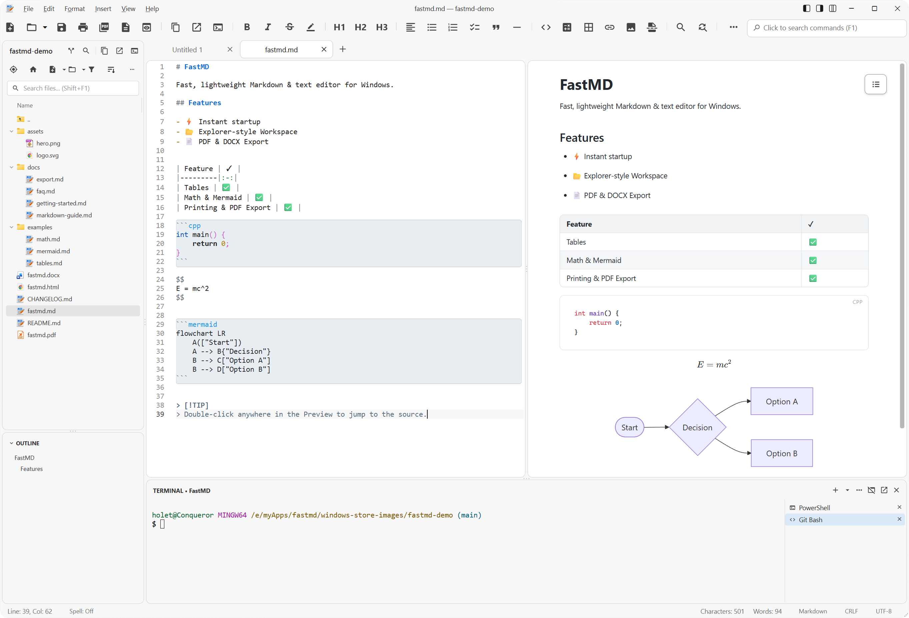
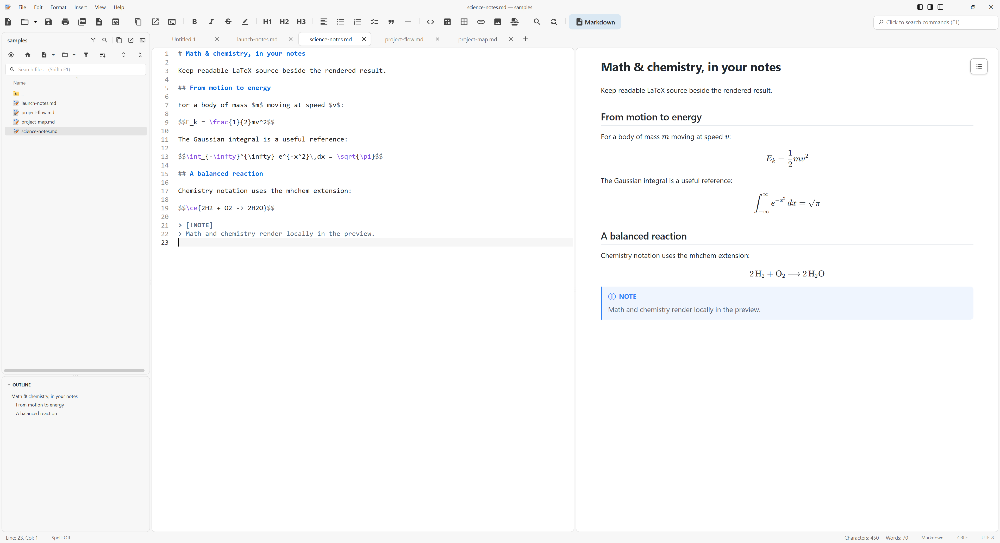
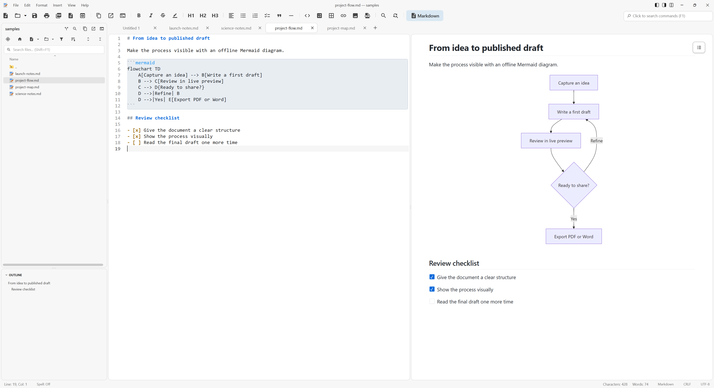
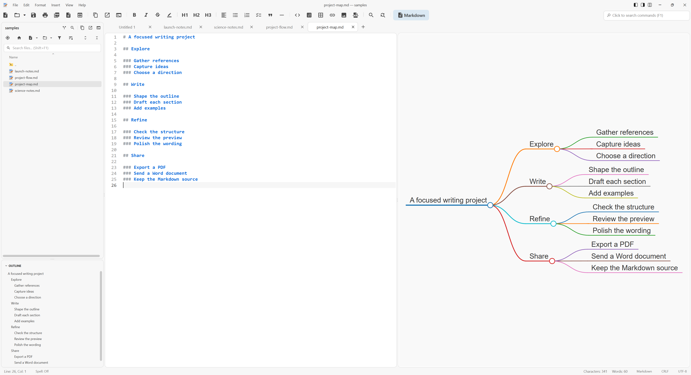
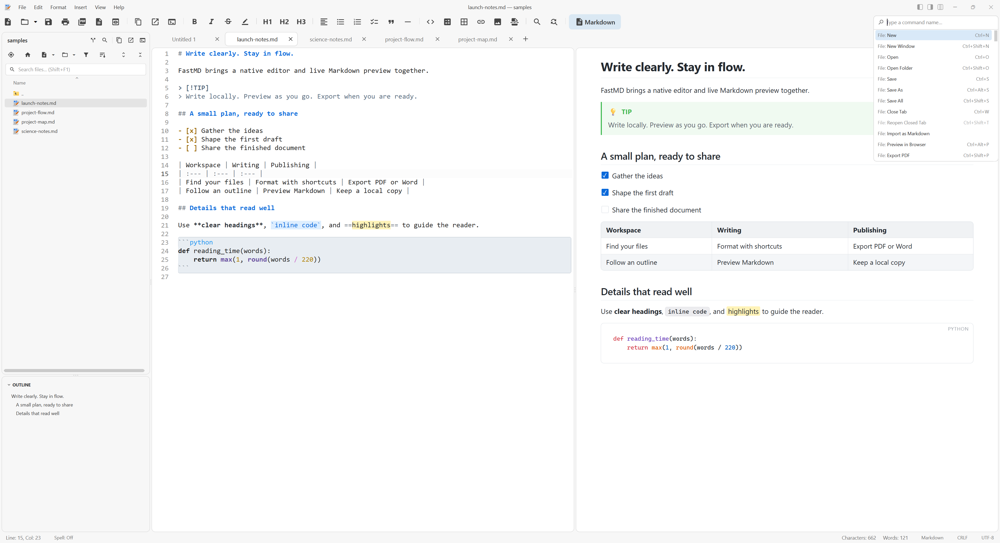

# FastMD

**A fast, native Markdown and text editor for Windows.** Write in a focused editor, see a live preview beside it, and export documents without sending them to a cloud converter.

[Microsoft Store](https://apps.microsoft.com/detail/9N4DSD4WNZ9D) · [Website](https://skypediacode.github.io/fastmd/) · [Screenshots](https://skypediacode.github.io/fastmd/screenshots.html) · [Release notes](RELEASES.md) · [Privacy policy](https://skypediacode.github.io/fastmd/privacy-policy.html)



## Download

| Channel | What you get |
| --- | --- |
| **[Microsoft Store](https://apps.microsoft.com/detail/9N4DSD4WNZ9D)** | The primary install and automatic update channel. |
| **[Store installer](https://github.com/skypediacode/fastmd/releases/download/store-installer/FastMD.Installer.exe)** | A small, permanent launcher. It installs the version currently available to your account through Microsoft Store. Store access is required; it is not an offline installer. |
| **[GitHub Releases](https://github.com/skypediacode/fastmd/releases)** | Release notes only. Standalone EXE, MSI, and portable packages are not published. |

See [release information](RELEASES.md) for version history and packaging details.

## Features

**Writing**

- Markdown and code editing with syntax highlighting, multiple tabs, and a document outline (`Ctrl+G` → Outline).
- Tables, task lists, callouts, footnotes, definition lists, and highlighted marks.
- Searchable command palette (`F1`) for every application command.
- Spell checking with the Windows Spell Checking API, using the languages you have installed in Windows.
- Auto Save with recovery for untitled and unsaved documents.

**Live preview and rendering**

- Rendered Markdown beside your source, with synchronized scrolling.
- Double-click in the preview to jump to the matching source line.
- Offline Mermaid diagrams and math rendered with KaTeX, including the `mhchem` extension for chemistry.
- Visual Math and Chemistry toolbars for inserting notation.
- Interactive mind map (`F10`) built from your document's headings.

**Workspace**

- File tree, file search (`Shift+F1`), and a terminal panel.
- Source Control mode (`Ctrl+Shift+G`): status, staging, commits, history, and read-only diffs. Git runs only on explicit actions and never on the typing path.

**Export and viewers**

- PDF export with heading bookmarks, page headers and footers, and Chromium rendering that matches the preview.
- Word, HTML, EPUB, RTF, OpenDocument, LaTeX, and plain text.
- Viewer tabs for images, SVG, PDF, and HTML.

**Command line**

```bat
fastmd
fastmd README.md
fastmd file1.md file2.md
fastmd C:\Project
fastmd notes.md -o notes.pdf
```

Files open as tabs; a folder sets the Workspace root. With `-o`, FastMD exports a Markdown document to PDF and returns the exit status to the shell.

| Math and chemistry | Mermaid diagrams |
| --- | --- |
|  |  |

| Interactive mind map | Command palette |
| --- | --- |
|  |  |

[View full-size screenshots and capture details](https://skypediacode.github.io/fastmd/screenshots.html). All five images are real captures of FastMD on Windows, using the [public demo documents](docs/screenshots/samples). No UI has been generated or composited.

## System requirements

- **OS:** Windows 10 version 1809 or later, or Windows 11.
- **Architectures:** x64 and Arm64.
- **Microsoft Edge WebView2 Runtime** (Evergreen): needed for the live preview, browser-based exports, and the Terminal. It ships with Windows 11 and is installed on many Windows 10 systems. Without it, the editor still works and the preview shows a message instead.

## Native by design

FastMD is written in C++20 with Qt 6 Widgets. The editor and application UI are native. The Markdown preview uses the shared Evergreen Microsoft Edge WebView2 runtime, created lazily and never bundled. FastMD does not include Chromium and does not use Electron or Qt WebEngine.

Markdown parsing, preview assets, and document conversion run locally. Microsoft Store handles installation and updates. External links and explicit Git operations can use the network.

## Building from source

Building is supported on Windows 10/11 x64. Arm64 packages are cross-compiled from x64 (see below).

### Requirements

- **Visual Studio 2022** (Build Tools or a full edition) with the *Desktop development with C++* workload.
- **Qt 6.11.1** with the `MSVC 2022 64-bit` kit, installed with the Qt Online Installer. Also install the **CMake** and **Ninja** tools from the same installer. The default location is `C:\Qt`; set `FASTMD_QT_ROOT` if you installed elsewhere.
- **Git** and internet access. The build downloads md4c, KDE syntax-highlighting and Extra CMake Modules from GitHub, and the WebView2 SDK from NuGet.

### Build

```powershell
git clone https://github.com/skypediacode/fastmd.git C:\src\fastmd
cd C:\src\fastmd
.\scripts\build.ps1
```

The result is `build\FastMD.exe`. Run it with the Microsoft Edge WebView2 Runtime installed (see [System requirements](#system-requirements)).

> **Keep the clone path short**, for example `C:\src\fastmd`. With the source in a path about 150 characters long, the MSVC build failed with `C1083: Cannot open compiler generated file`; the same source in a short path built successfully.

No Git? Download the source ZIP from the repository page and extract it to a short path. The build does not need the `.git` folder.

### Other options

```powershell
.\scripts\build.ps1 -Architecture arm64  # build-arm64\FastMD.exe. Requires the Qt MSVC 2022 ARM64 kit, the
                                         # ARM64 MSVC build tools, and a completed x64 build first.
.\scripts\build.ps1 -Clean               # delete the build folder first
.\scripts\sync-bundled-tools.ps1         # optional: Pandoc and AnyDoc (see below)
```

**Pandoc and AnyDoc (optional).** The DOCX, EPUB, ODT, RTF and LaTeX exports, and *Import as Markdown*, use two bundled tools that are not stored in the repository. Without them the build still succeeds, but those features need the tools to be present. `scripts\sync-bundled-tools.ps1` downloads Pandoc, compiles AnyDoc with Rust (`cargo`), and records the SHA-256 hash of each. It does not compare the hashes with the ones committed to the repository, and a different Rust toolchain produces a different AnyDoc hash, so `git status` will show the updated hash files afterwards. For an Arm64 build, run it with `-Architecture arm64`. See [dev-docs/BUNDLED_TOOLS.md](dev-docs/BUNDLED_TOOLS.md).

**Advanced: CMake directly.** `build.ps1` only loads the MSVC environment and calls CMake. From a *Developer PowerShell for VS 2022*, you can run the same CMake configuration yourself; read `scripts\build.ps1` for the exact arguments.

## Repository layout

| Path | Contents |
| --- | --- |
| `src/`, `resources/`, `tests/`, `tools/` | Application, bundled assets, automated tests, and bundled-tool manifests |
| `scripts/` | Build helpers, bundled-tool sync, and icon generators |
| `dev-docs/` | Maintainer documentation (bundled tools, shell extension, crash diagnostics) |
| `docs/` | The [GitHub Pages website](https://skypediacode.github.io/fastmd/) and screenshots |
| `CHANGELOG.md`, `RELEASES.md` | Version history and release information |

## Reporting issues

For a reproducible report, include your FastMD version, Windows version, the steps you took, and a small example document with private content removed. Open it on the [issue tracker](https://github.com/skypediacode/fastmd/issues).

## Credits

FastMD builds on these open-source components:

| Component | Use | License |
| --- | --- | --- |
| [Qt](https://www.qt.io) 6.11 | Application framework | LGPL v3 |
| [md4c](https://github.com/mity/md4c) 0.5.2 | Markdown parser | MIT |
| [KSyntaxHighlighting](https://invent.kde.org/frameworks/syntax-highlighting) 6.28 | Editor syntax highlighting | MIT |
| [KaTeX](https://katex.org) | Math rendering | MIT |
| [highlight.js](https://highlightjs.org) | Code block highlighting | BSD 3-Clause |
| [Mermaid](https://mermaid.js.org) | Diagrams | MIT |
| [Markmap](https://markmap.js.org) | Mind maps | MIT |
| [xterm.js](https://xtermjs.org) | Terminal | MIT |
| [Pandoc](https://pandoc.org) | Document conversion (bundled tool) | GPL v2 or later |
| [AnyDoc](https://github.com/firecrawl/anydoc) | Document import (bundled tool) | MIT |
| [Material Icons](https://fonts.google.com/icons) | UI icons | Apache 2.0 |
| [Codicons](https://github.com/microsoft/vscode-codicons) | Title-bar icons | CC BY 4.0 |

Full notices are in the app under **Help → Third-Party Licenses**, and on the [third-party notices page](https://skypediacode.github.io/fastmd/licenses.html).

## License

FastMD is open source software released under the [MIT License](LICENSE). You may use, copy, modify, merge, publish, distribute, sublicense, and sell it. Every copy or substantial portion of the source must keep the copyright notice and license text.

Copyright © 2026 Skypedia.
