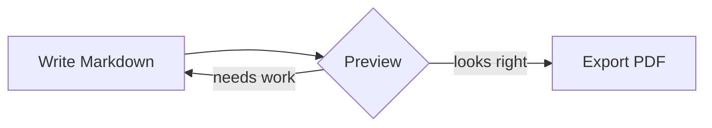

# FastMD User Guide

A short tour of the things that are easy to miss. This document is bundled with
FastMD, opens offline, and is read-only — edit a copy of anything you want to
keep.

Press **F11** to leave Reading Mode and see the Markdown source of this page
side by side with the preview.

## Contents

- [1. The layout](#1-the-layout)
- [2. Markdown and GitHub-flavored Markdown](#2-markdown-and-github-flavored-markdown)
- [3. Callouts](#3-callouts)
- [4. Math with LaTeX / KaTeX](#4-math-with-latex-katex)
- [5. Chemistry with mhchem](#5-chemistry-with-mhchem)
- [6. Mermaid diagrams](#6-mermaid-diagrams)
- [7. Fenced code](#7-fenced-code)
- [8. Footnotes, definition lists, TOC and page breaks](#8-footnotes-definition-lists-toc-and-page-breaks)
- [9. Preview interaction and navigation](#9-preview-interaction-and-navigation)
- [10. Workspace panel](#10-workspace-panel)
- [11. Terminal](#11-terminal)
- [12. Source Control (Git)](#12-source-control-git)
- [13. Files FastMD opens](#13-files-fastmd-opens)
- [14. Import, export and printing](#14-import-export-and-printing)
- [15. Menu guide](#15-menu-guide)
- [16. Editing shortcuts worth knowing](#16-editing-shortcuts-worth-knowing)
- [17. Tabs and windows](#17-tabs-and-windows)
- [18. Command line and Windows Explorer](#18-command-line-and-windows-explorer)
- [19. Saving, Auto Save and recovery](#19-saving-auto-save-and-recovery)
- [20. Preferences worth a look](#20-preferences-worth-a-look)

> [!TIP]
> You don't have to write these by hand: put `[TOC]` on its own line and FastMD
> builds the list from the document's real headings at render time. See
> [section 8](#8-footnotes-definition-lists-toc-and-page-breaks).

---

## 1. The layout

| Part | Toggle |
| --- | --- |
| Source Control (Git) | `F7` |
| Workspace panel (file tree) | `F8` |
| Preview | `F9` |
| Mind map | `F10` |
| Reading Mode (preview only) | `F11` |
| Notepad Mode (editor only) | `F12` |
| Command Palette | `F1` |
| Status bar | View ▸ Status Bar |
| Math / Chemistry toolbars | View ▸ Toolbars, or right-click the toolbar |

The **Command Palette** (`F1`, or the search box at the right end of the
toolbar) finds every menu and toolbar command by name. It also matches
synonyms, so typing `pdf`, `wrap`, `h1` or `prettify` lands on the right
command.

**Reading Mode** hides the editor and gives the whole window to the preview.
`Ctrl+F` in Reading Mode searches the *rendered page* instead of the Markdown
source. It is a temporary view: your normal editor/preview split is untouched.

**Notepad Mode** hides the preview and Workspace panel so you can focus on
writing in the editor. It is also a temporary view: your preview, Workspace,
and splitter preferences are restored when you leave the mode. Reading Mode
and Notepad Mode are mutually exclusive.

---

## 2. Markdown and GitHub-flavored Markdown

Standard CommonMark plus tables, strikethrough and task lists.

```markdown
| Feature | Status |
| ------- | :----: |
| Tables  |   ✅   |

- [x] Done
- [ ] Not done

~~struck through~~
```

Task list checkboxes are **clickable in the preview** — ticking one rewrites the
Markdown source.

Some extras beyond GFM:

```markdown
==highlighted==      H~2~O (subscript)      x^2^ (superscript)
:rocket: :bulb: :white_check_mark:
```

Emoji shortcodes cover a common set; for anything else use the Windows emoji
panel (`Win+.`).

### Auto Format Document

`Shift+Alt+F` tidies the document (or just the selection): it repairs stale
ordered-list numbering and aligns table pipes into neat columns without
changing what the table renders as.

### Links

Use an inline link when its destination belongs beside the text:

```markdown
[FastMD](https://skypediacode.github.io/fastmd/ "FastMD website")
```

For citations and repeated destinations, use a numbered reference-style link.
Definitions do not appear in Preview; their optional title is shown as the link
tooltip. Insert ▸ Links ▸ Insert Reference Link (Ctrl+Shift+K) inserts the
next numbered marker and its definition at the end of the document together.

```markdown
FastMD is a native Markdown editor.[1]

[1]: https://skypediacode.github.io/fastmd/ "FastMD website"
```

---

## 3. Callouts

GitHub-style callouts, from Edit ▸ Insert Callouts:

```markdown
> [!NOTE]
> Useful information the reader should notice.

> [!TIP]
> A helpful suggestion.

> [!IMPORTANT]
> Crucial information.

> [!WARNING]
> Urgent information.

> [!CAUTION]
> Risks or negative outcomes.
```

> [!TIP]
> Callouts are just blockquotes, so they survive HTML, PDF and DOCX export.

---

## 4. Math with LaTeX / KaTeX

Four delimiter styles are recognised, inline and display:

```markdown
Inline: $E = mc^2$ or \(E = mc^2\)

$$
\int_{0}^{\infty} e^{-x^2}\,dx = \frac{\sqrt{\pi}}{2}
$$
```

Which renders as:

$$
\int_{0}^{\infty} e^{-x^2}\,dx = \frac{\sqrt{\pi}}{2}
$$

- `Ctrl+Shift+M` inserts inline math, `Ctrl+Shift+B` a math block.
- **View ▸ Toolbars ▸ Math Toolbar** gives a categorized symbol palette
  (functions, matrices, integrals, Greek, relations …) with real KaTeX previews
  on every button.
- Math is typeset by the bundled KaTeX — no internet connection, and the same
  rendering is used for the preview, HTML export, browser preview and PDF.

---

## 5. Chemistry with mhchem

KaTeX's `mhchem` extension is bundled, so `\ce{}` works anywhere math does:

```markdown
Inline: $\ce{H2O}$, $\ce{SO4^2-}$, $\ce{CO2 + C -> 2CO}$

$$
\ce{Zn^2+ <=>[+ 2OH-][+ 2H+] Zn(OH)2 v}
$$
```

$$
\ce{Zn^2+ <=>[+ 2OH-][+ 2H+] Zn(OH)2 v}
$$

**View ▸ Toolbars ▸ Chemistry Toolbar** has the arrows, states, charges and
bond notation ready to insert.

---

## 6. Mermaid diagrams

Use a fenced block labelled `mermaid`:

````markdown

````


Flowcharts, sequence, class, state, ER, Gantt, pie and journey diagrams all
work. **Right-click a rendered diagram** to copy or save it as SVG or PNG.

---

## 7. Fenced code

Label the fence to get syntax highlighting and a language badge in the
top-right corner of the block:

````markdown
```python
def greet(name: str) -> str:
    return f"Hello, {name}"
```
````

```python
def greet(name: str) -> str:
    return f"Hello, {name}"
```

Unlabelled fences stay plain on purpose, so prose in a code block is never
mistaken for a language.

The **editor** highlights fenced code per language too, not just the preview.

---

## 8. Footnotes, definition lists, TOC and page breaks

```markdown
Footnotes[^1] are numbered automatically.

[^1]: The definition can live anywhere in the document.

Term
: The definition, indented with a colon.
```

Footnotes[^guide-fn] are numbered automatically.

[^guide-fn]: Insert one with `Ctrl+Alt+F`, or a named one with `Ctrl+Alt+Shift+F`.

Term
: The definition, indented with a colon.

**Table of contents** — Edit ▸ Insert Table of Content offers two kinds:

- *Static*: writes a real Markdown list of links you can edit.
- *Dynamic*: writes `[TOC]`, which is expanded at render time and always
  matches the current headings.

**Page break** — `Ctrl+Enter` inserts a marker that starts a new page in PDF
export and printing, and is invisible on screen:

```html
<div style="break-after: page;"></div>
```

**Front matter** — a YAML block at the very top of the file sets the exported
document's metadata instead of appearing in the text:

```markdown
---
title: Quarterly Report
author: Your Name
description: Results for Q3
keywords: report, finance
---
```

These become the HTML `<title>`/`<meta>` tags and the PDF document properties.

---

## 9. Preview interaction and navigation

- **Double-click anything in the preview** to jump to the exact line that
  produced it — including individual lines of a paragraph, list or heading.
- **Right-click a selection ▸ Go to Source** does the same from the menu.
- Editor and preview scroll together.
- The **outline button** at the top-right of the preview opens a searchable
  heading tree; it can be pinned so it stays open.
- `Ctrl+G` opens **Go To**, with a *Line* tab for line numbers and an
  *Outline* tab you can type into and navigate with the arrow keys.
- `Alt+←` / `Alt+→` walk back and forward through your jump history.
- `F10` renders the document as an interactive **mind map**; double-clicking a
  node jumps to its source, and it can be exported to HTML, PDF, DOCX or SVG.

---

## 10. Workspace panel

`F8` shows a persistent file tree with a real root folder (File ▸ Open
Folder…, or drop a folder onto the window).

- Type in its search box for a recursive search across the folder.
- Drag files and folders inside the tree to **move** them; drag them in from
  Explorer to **copy** them.
- `Del` sends to the Recycle Bin, `F2`-style inline rename is in the context
  menu, and **Reveal in Explorer** for the selected tree item is `Shift+Alt+R`.
- **Open as Source** in the context menu opens any file as raw text — useful
  for HTML, or for a file type FastMD would otherwise hand to another app.
- The **Show All** filter is remembered per folder.

**Search in Files** searches the text of every file in the workspace, not just
file names. Press `Ctrl+Shift+F`, or click the magnifier in the Workspace header
(click it again to return to the file tree).

- The **Aa**, **ab** and **.\*** buttons switch on Match Case, Match Whole Word
  and Regular Expression (`Alt+C`, `Alt+W`, `Alt+R`). These options belong to
  Search in Files and are independent of the document Find bar.
- Results are grouped by file; click a result to jump to it. A file that is open
  is searched from its editor, so unsaved changes are found.
- `Ctrl+Shift+H` (or the arrow beside the search field) opens the **Replace**
  row. Hover a result for **Replace** (`Ctrl+Shift+1`) or a file for **Replace
  All in File**; the button in the Replace row replaces every result and asks
  first when more than one file is affected.
- Replacing in an open document edits its editor, so it stays unsaved and
  `Ctrl+Z` undoes a file's replacements in one step. Files that are not open are
  rewritten on disk with their own encoding and line endings; that cannot be
  undone.
- `.git`, `node_modules`, `build*`, `dist` and `out` folders, binary files and
  files over 5 MB are skipped.

---

## 11. Terminal

Press **F6** or choose View ▸ **Terminal** to open FastMD's integrated terminal.
New sessions use the workspace folder, or the current file's folder when no
workspace is open; **Open Workspace in Terminal** in the Workspace header starts
one at the workspace root. **Open Folder in Terminal** starts one in the selected
document's parent folder or the right-clicked Workspace item's folder. Use
the header controls to create or close sessions, choose a shell profile, or
detach the terminal into its own window. When the terminal has focus, `Ctrl++`,
`Ctrl+-`, and `Ctrl+0` adjust its font size.

---

## 12. Source Control (Git)

`F7` (or View ▸ Source Control) opens the built-in Git Source Control mode in the
workspace panel. You can also switch between the file tree and Source Control using
the mode toggle in the workspace header bar.

- **Changes and Staging**: Tracked edits and untracked files are organized into
  *Changes*, *Staged Changes*, and *Merge Conflicts*. Hover over a file to stage
  (`+`), unstage (`-`), discard changes, or open the file. Use the section headers
  to stage, unstage, or discard all changes at once.
- **Side-by-Side Diffs**: Double-click any changed file to open a dedicated,
  side-by-side diff document tab with line-number gutters. Diffs update live as you
  edit or stage.
- **Commit and Push**: Enter a commit message and press `Ctrl+Enter` (or click
  *Commit* / *Stage All + Commit*). The commit button adapts to *Sync Changes* or
  *Publish Branch* with incoming (`↓`) and outgoing (`↑`) commit indicators.
- **Commit History and Graph**: The lower section displays the visual commit graph
  and history. Click any commit to view the files modified in that commit, and
  double-click a file to inspect its diff against the parent commit.
- **Branch Switching**: Click the branch button (`⑂ branch ▾`) in the Graph header
  to search and switch between local and remote tracking branches.
- **Safe and Local**: Shells out directly to `git` on your `PATH` without background
  daemons. Discarding untracked files safely moves them to the Recycle Bin.

---

## 13. Files FastMD opens

| Type | Behavior |
| --- | --- |
| `.md`, `.markdown`, `.mdown`, `.mkd` | Markdown editor + preview |
| `.txt` and any code/text file | Editor with per-language syntax highlighting |
| `.pdf` | Read-only viewer |
| `.html`, `.htm` | Read-only viewer (or open as source) |
| `.svg` | Read-only viewer |
| Images (PNG, JPEG, GIF, BMP, ICO, and WebP/TIFF when available) | Native image viewer with zoom, fit, 1:1 and rotate |

The language of an editable document is shown in the status bar — click it to
change it, or to switch between Markdown and Code/Text (`Ctrl+M`). A manual
choice sticks across renaming and restarts.

Next to it, two more status-bar buttons show the document's **line ending**
(CRLF / LF / CR) and **encoding** (UTF-8, UTF-8 with BOM, UTF-16 LE/BE).
Changing either applies on the next save; it never rewrites the file behind
your back.

---

## 14. Import, export and printing

**File ▸ Import as Markdown…** converts DOCX, ODT, RTF, EPUB, CSV and
text-based PDF into Markdown. The result is written next to the original
(`Report.docx` → `Report.md`, never overwriting an existing file) and opens as
an ordinary document. Embedded images become alt text rather than files.

**Export** — all offline, all matching what the preview shows:

| Format | Shortcut |
| --- | --- |
| PDF | `Ctrl+Shift+P` |
| DOCX | `Ctrl+Shift+D` |
| HTML (single self-contained file) | File ▸ Export HTML… |
| EPUB, Plain Text, RTF, ODT, LaTeX | File ▸ Export As |
| Mind map (HTML / PDF / DOCX / SVG) | Right-click the mind map |

`Ctrl+Alt+P` opens the document in your browser; `Ctrl+P` prints it.
**File ▸ Page Setup…** controls the paper size, orientation, margins and base
font used by PDF export and printing.

To convert a Markdown file to PDF from a terminal or script, see
[18. Command line and Windows Explorer](#18-command-line-and-windows-explorer).

Exported HTML is one portable file with KaTeX, highlight.js and Mermaid
embedded — it renders correctly with no network access.

---

## 15. Menu guide

The menu bar is deliberately small; this section explains the commands whose
names do not fully describe their effect. Most ordinary commands also appear
in the Command Palette (`F1`).

### File

- **Preview in Browser** opens a temporary, interactive rendering for checking
  the current document. **Export HTML** writes a permanent, self-contained
  file instead.
- **Import as Markdown** creates a neighbouring `.md` copy of a supported
  document; it does not modify the original. **Export As** is for the less
  common output formats, while the direct PDF, DOCX and HTML commands are the
  quickest route to those formats.
- **Page Setup** affects printed pages and PDF export, not the editor or live
  preview. **Reopen Closed Tab** can restore an unsaved scratch document too.

### Edit

- **Back** and **Forward** return to locations reached through preview/source
  navigation, Go To, and similar jumps; they are not undo and redo.
- **Find** searches the Workspace panel when that panel has focus; otherwise it
  searches the active document. **Go To Line** also has an Outline tab for
  heading navigation.
- **Line** commands operate on the selected whole lines, or the entire document
  when nothing is selected. **Join Lines** is a literal cleanup operation: it
  trims lines, drops blank ones, and joins the rest with spaces. Use
  **Whitespace ▸ Join Wrapped Lines** when you want Markdown-aware paragraph
  unwrapping that avoids code blocks, lists, tables, and other structure.
- **Split Lines…** asks whether commas, semicolons, or tabs should become line
  breaks. **Sort Lines**, **Remove Duplicate Lines**, and **Unique + Sort** use
  exact line text; whitespace differences therefore make lines distinct.
- **Whitespace** commands also use the selected lines or whole document.
  **Normalize Whitespace** trims each line and collapses its internal whitespace.
  **Convert Spaces to Tabs** changes indentation only, so prose spacing is safe.
  **Remove Invisible Characters** removes zero-width and control characters but
  keeps ordinary tabs and line breaks.
- **EOL Conversion** chooses the line ending to write on the next save; it does
  not immediately rewrite the file. **Spell Check ▸ Fix All Misspellings** lets
  you review replacements before applying them.

### Format

- **Align Center**, **Right**, and **Justify** wrap the selected block in a
  portable HTML alignment block. **Align Left** removes that wrapper because
  normal Markdown is already left-aligned.
- **Update List Numbers** repairs ordered-list markers; **Update Section
  Numbers** refreshes numbered headings. **Auto Format Document** combines the
  useful document cleanup work, including table alignment, without changing
  what the Markdown renders as.

### Insert

- **Static Markdown TOC** writes an editable list now. **Dynamic ([TOC])**
  inserts a marker that always follows the current headings in the preview and
  exports. **Date & Time ▸ Custom** accepts a Qt date/time format such as
  `yyyy-MM-dd HH:mm`.

### View

- **Preview Panel** shows or hides the normal side-by-side preview. **Reading
  Mode** is preview-only; **Notepad Mode** is editor-only and also hides the
  Workspace panel. Both restore the layout underneath when turned off.
- **Source Control** opens FastMD's built-in Git interface in the left panel.
  It shares that space with the **Workspace Panel**, so switching between them
  does not close documents or change the workspace root. **View as Mind Map**
  is available for Markdown documents.
- **Word Wrap** changes only the editor display, never the file's line endings.
  **Document Statistics** reports counts without editing the document. The
  Math and Chemistry toolbars are optional symbol palettes, not separate modes.
- **Zoom In**, **Zoom Out**, and **Reset Zoom** affect the active view: the
  editor, an image, an HTML/SVG viewer, or a diff. They do not change the
  document's stored font size or image file.

### Help

- **Copy Folder Path**, **Reveal Workspace in Explorer**, and **Open Workspace in Terminal** are
  available in the Workspace panel header when a workspace folder is open.
- File-specific actions such as **Copy Path** and **Reveal in Explorer** remain
  available from the relevant tab or editor context menus. The Workspace tree's
  context menu and row button can reveal the clicked item; its context menu can
  also open the item's folder in the terminal.
- **Keyboard Shortcuts** is the complete reference. **Release Notes** explains
  version changes; **Third-Party Licenses** lists bundled component notices;
  and **About FastMD** shows the application version. **Check for Updates**,
  the Store, GitHub, and issue-report entries may open a web page.

---

## 16. Editing shortcuts worth knowing

| Action | Shortcut |
| --- | --- |
| Bold / Italic / Strikethrough | `Ctrl+B` / `Ctrl+I` / `Ctrl+Shift+-` |
| Highlight | `Ctrl+Alt+Shift+H` |
| Heading 1–6 | `Ctrl+1` through `Ctrl+6` |
| Bullet / Numbered / Checklist | `Ctrl+Shift+U` / `Ctrl+Shift+O` / `Ctrl+Shift+X` |
| Blockquote | `Ctrl+Shift+Q` |
| Code Block | ``Ctrl+` `` |
| Inline Link / Numbered Reference Link / Image | `Ctrl+K` / `Ctrl+Shift+K` / `Ctrl+Shift+I` |
| Table | `Ctrl+Alt+T` (size picker) |
| Subscript / Superscript | `Ctrl+Shift+,` / `Ctrl+Shift+.` |
| Horizontal rule / Page break | `Ctrl+Alt+H` / `Ctrl+Enter` |
| Footnote / Named footnote | `Ctrl+Alt+F` / `Ctrl+Alt+Shift+F` |
| Refresh (Workspace tree, Preview, or Source Control -- whichever has focus) | `F5` |
| Insert date/time | Insert ▸ Date & Time (Short/Long/Custom format) |
| Duplicate line / Delete line | `Ctrl+D` / `Ctrl+R` |
| Move line up / down | `Alt+↑` / `Alt+↓` |
| Word wrap | `Alt+Z` |
| New tab / New window | `Ctrl+N` or `Ctrl+T` / `Ctrl+Shift+N` |
| Close tab / Reopen closed tab | `Ctrl+W` / `Ctrl+Shift+T` |
| Zoom in / out / reset | `Ctrl++` / `Ctrl+-` / `Ctrl+0` |

Edit ▸ **Convert Case** and Edit ▸ **Whitespace** apply bulk transforms
(UPPERCASE, Proper Case, join wrapped lines, trim spaces, remove empty lines)
as a single undoable step.

The full list is in **Help ▸ Keyboard Shortcuts…**.

### Spell checking

Enable **Spell Check** and choose a Windows spelling language in Preferences ▸
Editor. If none are installed, use **Manage Windows language settings…**.

Misspelled prose is underlined in Markdown and plain-text documents. Markdown
syntax, link destinations and code fences are skipped, but visible link text
is checked. Use the **Spell: …** status-bar button, **Edit ▸ Spell Check**, or
the Command Palette (`F1`) to control checking, choose a language, open
settings, or run **Fix All Misspellings**.

Right-click an underlined word for suggestions, **Ignore Word** (session-only),
or **Add to Dictionary** (Windows per-user dictionary). **Fix All Misspellings**
lets you review and apply suggested replacements.

---

## 17. Tabs and windows

- Drag a tab out of the window to detach it, or onto another FastMD window to
  move it there.
- A file can only be open in one editable tab at a time; opening it again
  activates the tab that already has it.
- `Ctrl+Shift+T` reopens the last closed tab, including unsaved untitled text
  and its cursor position.
- Double-click empty space on the tab bar (or press the `+`) for a new tab.

---

## 18. Command line and Windows Explorer

FastMD integrates directly into Windows File Explorer and your terminal workflow.

- **Edit with FastMD**: Right-click any file in Windows File Explorer to open it
  in FastMD, or right-click a folder (or empty space inside a folder) and choose
  **Edit with FastMD** to open that folder as the active Workspace panel root.
- **Single-instance handoff**: Opening files or folders from File Explorer or the
  terminal automatically creates a new tab in your running FastMD window and brings
  it to focus, rather than launching duplicate processes.
- **Open files**: Run `fastmd <file>` or pass multiple paths (e.g. `fastmd doc1.md doc2.md`).
- **Open folders**: Pass a folder path (e.g. `fastmd .` or `fastmd C:\Projects\MyDocs`)
  to open that directory as the active Workspace panel root. Files and folders can
  be combined in one launch.
- **Wildcard expansion**: FastMD resolves wildcard arguments against the current
  directory, such as `fastmd docs\*.md`.
- **Force a new window**: Use `--new-window` (e.g. `fastmd --new-window notes.md`)
  to launch a separate FastMD window instead of reusing the active window.
- **Start in Notepad Mode**: Use `--notepad` (e.g. `fastmd --notepad notes.md`)
  to start with the preview and Workspace panel hidden. Combine it with
  `--new-window` when FastMD is already running and the new window must start in
  Notepad Mode; without `--new-window`, only the file paths are handed to the
  existing window.
- **Argument syntax**: Switches may be placed before or after paths. Existing
  files and directories are opened; nonexistent non-wildcard paths are ignored.
- **Drag and drop**: Drop any file or folder directly onto FastMD to open documents
  or switch the workspace folder.

**Convert Markdown to PDF** without opening a window:

```text
fastmd notes.md -o notes.pdf
fastmd "C:\My Notes\read me.md" --output "C:\Exports\read me.pdf" --force
```

- Give exactly one input file and an output path ending in `.pdf`; `-o` and
  `--output` are the same switch and may come before or after the input.
  Relative paths are resolved against the current folder.
- If the output file already exists, the conversion stops and the file is left
  untouched. Add `--force` to replace it; the old file is only replaced once the
  new PDF has been rendered successfully.
- No window opens, and an already running FastMD window is not affected or
  brought to the front. The conversion cannot be combined with `--new-window`,
  `--notepad` or `--restart`.
- The PDF matches **File ▸ Export PDF…**: it uses your saved **File ▸ Page Setup…**
  options and renders math, Mermaid diagrams, code highlighting and relative
  images. It always uses the light theme, and the document is always exported
  as a document, never as a mind map.
- It needs the Microsoft Edge WebView2 Runtime (or an installed Edge/Chrome), like
  PDF export in the app. Only read access to the input and its folder is
  needed: the temporary rendering files go to the system temp folder, and only
  the output folder must be writable.
- Exit codes: `0` success, `1` the export failed, `2` invalid command line,
  `3` a file problem (input missing or not text, output already exists, output
  folder missing). Error messages are printed to the terminal.
- `fastmd` behaves like any other console command: cmd and PowerShell wait for
  the conversion to finish, errors appear before the next prompt, and
  `%ERRORLEVEL%` / `$LASTEXITCODE` hold the exit code. Error output can be
  redirected (`2> errors.txt`) or piped. `Ctrl+C` cancels the conversion and
  leaves any existing output file untouched.
- The short `fastmd` command is only available in the Microsoft Store (MSIX)
  install. The portable and installer versions are not on `PATH`; call
  `FastMDLauncher.exe` from the FastMD folder instead — for the installer
  version, by default
  `"%LOCALAPPDATA%\Programs\FastMD\FastMDLauncher.exe" notes.md -o notes.pdf`.
  `FastMD.exe` itself accepts the same arguments, but as a Windows app it is
  not waited for by an interactive cmd or PowerShell prompt.

---

## 19. Saving, Auto Save and recovery

- **Auto Save** is off by default. Turn it on in File ▸ Preferences; it writes
  saved documents back to their own file after a short pause in typing.
- **Crash recovery** keeps a private snapshot of unsaved and untitled work in
  the application data folder — never in your document folders — and offers to
  restore it on the next launch.
- The small icon at the right of the status bar shows unsaved / saving / saved.
- If a file changes outside FastMD while you have unsaved edits, FastMD tells
  you and lets you reload or keep your version; it never overwrites silently.

---

## 20. Preferences worth a look

File ▸ **Preferences…** (`Ctrl+,`)

- Theme (Light / Dark / System) — also View ▸ Theme.
- Default editor font size, and whether the current line is highlighted.
- Whether a single line break renders as a line break.
- Restore the previous session on startup.
- Open PDF / HTML / image files in their default app instead of FastMD.
- Auto Save delay and crash-recovery behavior.
- Spell checking — enable it and choose a Windows spelling language on the
  Editor page.

---

*Help ▸ Release Notes…* lists what changed in each version, and
*Help ▸ Keyboard Shortcuts…* is the complete key reference.
