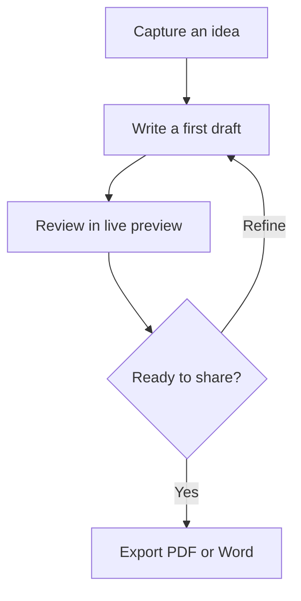

# From idea to published draft

Make the process visible with an offline Mermaid diagram.

## Review checklist

- [x] Give the document a clear structure
- [x] Show the process visually
- [ ] Read the final draft one more time
