# FastMD All Features Test

Use this document to exercise the editor, live preview, source mapping, and
HTML/PDF export. It intentionally contains standard Markdown plus FastMD
extensions. Try both light and dark themes, click task checkboxes, double-click
preview content, run Format Document, and export to HTML and PDF.

## Table of Contents

[TOC]

## Headings and paragraphs

# Heading 1
## Heading 2
### Heading 3
#### Heading 4
##### Heading 5
###### Heading 6

This is a normal paragraph with **bold**, *italic*, ***bold italic***,
~~strikethrough~~, ==highlighted text==, H~2~O, x^2^, `inline code`, and a
forced line break.  
The second line follows a Markdown hard break.

Setext heading
=============

## Links, images, HTML, and escaping

- [FastMD](https://fastmd.app)
- <https://example.com>
- <hello@example.com>
- [Reference link][fastmd]
- `https://example.com/a path/[1]` stays code.

[fastmd]: https://fastmd.app "FastMD website"


<details>
<summary>Native HTML block</summary>

This HTML content should remain visible and structurally intact.

</details>

Escaped punctuation: \*not italic\*, \# not a heading, \> not a quote,
\[not a link\], and \`not code\`.

## GitHub-style callouts

> [!NOTE]
> This is a note callout with **bold text**, a list, and inline math $a^2+b^2=c^2$.
>
> - First note item
> - Second note item

> [!TIP]
> Helpful tip: use `Ctrl+S` to save.

> [!WARNING]
> Warning: this is a deliberate test of warning styling.

> [!IMPORTANT]
> Important information belongs here.

> [!CAUTION]
> Caution: test this in both themes.

## Lists and task lists

### Unordered and nested lists

- Apple
- Banana
  - Nested item
    - Deeply nested item
- Orange

### Ordered and nested lists

1. First
2. Second
   1. Nested first
   2. Nested second
3. Third

### Interactive task list

- [ ] Unchecked task
- [x] Completed task
- [ ] Task with **bold**, `code`, and :rocket:
  - [x] Nested completed task
  - [ ] Nested pending task

## Tables

| Feature | Syntax | Status |
|:--------|:------:|-------:|
| Markdown | `**text**` | ✅ |
| KaTeX | `$x^2$` | ✅ |
| Mermaid | fenced block | ✅ |
| Chemistry | `\ce{H2O}` | ✅ |

## Blockquotes and horizontal rules

> A regular blockquote.
>
> It can contain **formatting** and nested quotes:
>
>> A nested blockquote.

---

***

___

## Footnotes

FastMD supports numbered and named footnotes.[^one] The same note can be
referenced again.[^one] A second note can contain a list.[^two]

[^one]: This is the first footnote with `inline code`.
[^two]: Second footnote:
    - detail one
    - detail two

## Definition lists

Markdown
: A lightweight markup language.

FastMD
: A native Windows Markdown editor.

Multiple terms
Another term
: Both terms may share a definition.

## Emoji shortcodes

:rocket: :warning: :smile: :grinning: :joy: :wink: :heart: :+1: :thumbsup:
:tada: :fire: :sparkles: :star: :white_check_mark: :x: :eyes: :thinking:
:clap: :pray: :wave: :ok_hand: :muscle: :coffee: :bug: :memo: :book: :bulb:
:gear: :lock: :key: :folder: :computer: :phone: :globe: :sunny:
:crescent_moon: :construction: :package: :email: :link:

## KaTeX math

Inline delimiters: $E=mc^2$, $\frac{a}{b}$, and $\alpha+\beta=\gamma$.

Alternative inline delimiters: \(x_i^2\) and \(\lim_{x\to0}\frac{\sin x}{x}=1\).

Display delimiters with common notation:

$$
\int_0^\infty e^{-x}\,dx = 1
$$

\[
\begin{aligned}
f(x) &= x^2+2x+1 \\
     &= (x+1)^2
\end{aligned}
\]

### Fractions, roots, scripts, accents, and delimiters

$$
\frac{1}{1+\frac{1}{x}},\qquad \sqrt{x^2+y^2},\qquad \sqrt[3]{x+y}
$$

$$
x_i^{n-1},\quad \vec v,\quad \overline{AB},\quad \hat x,\quad
\left\{\frac{a}{b}\right\},\quad \left\|x\right\|
$$

### Sums, products, integrals, matrices, cases, and sets

$$
\sum_{i=1}^{n} i = \frac{n(n+1)}{2},\qquad
\prod_{i=1}^{n} i = n!,\qquad \oint_C f(z)\,dz
$$

$$
\begin{pmatrix}1&2\\3&4\end{pmatrix},\quad
\begin{bmatrix}a&b\\c&d\end{bmatrix},\quad
\begin{cases}x+y=2\\x-y=1\end{cases}
$$

$$
A\subseteq B,\quad A\cup B,\quad A\cap B,\quad x\in A,\quad
\forall x\ \exists y,\quad P\Rightarrow Q,\quad a\approx b
$$

### Greek letters and number sets

$$
\alpha\ \beta\ \gamma\ \delta\ \theta\ \lambda\ \mu\ \pi\ \sigma\ \phi\ \omega
\qquad \Gamma\ \Delta\ \Theta\ \Lambda\ \Pi\ \Sigma\ \Phi\ \Omega
$$

$$
\mathbb{N}\quad\mathbb{Z}\quad\mathbb{Q}\quad\mathbb{R}\quad\mathbb{C}
$$

### Chemistry with KaTeX mhchem

Inline formulae: $\ce{H2O}$, $\ce{CO2}$, $\ce{NaCl(s)}$, $\ce{Na+(aq)}$,
$\ce{SO4^2-}$, $\ce{Ca^2+}$, and $\ce{^{14}_{6}C}$.

Reaction arrows and conditions:

$$
\ce{2H2 + O2 -> 2H2O}
$$

$$
\ce{N2 + 3H2 <=> 2NH3}
$$

$$
\ce{HCl + NaOH ->[neutralization] NaCl + H2O}
$$

$$
\ce{[Cu(NH3)4]^2+},\qquad \ce{Fe^{3+}},\qquad
\ce{CuSO4.5H2O},\qquad \ce{C_p(H2O(l)) = 75.3 J mol^{-1} K^{-1}}
$$

## Mermaid diagrams

### Flowchart

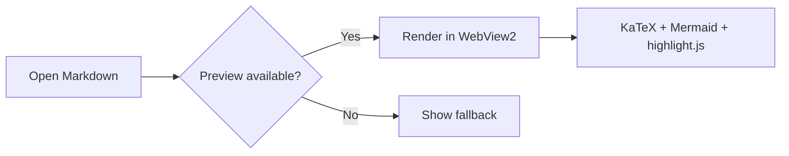

### Sequence diagram

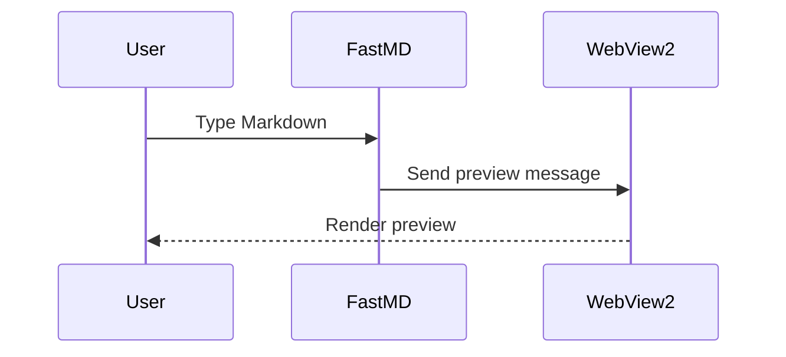

### Class diagram

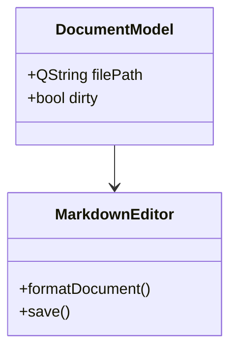

### State diagram

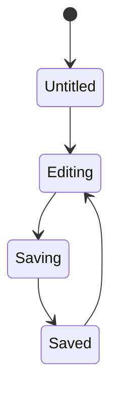

### Entity relationship diagram

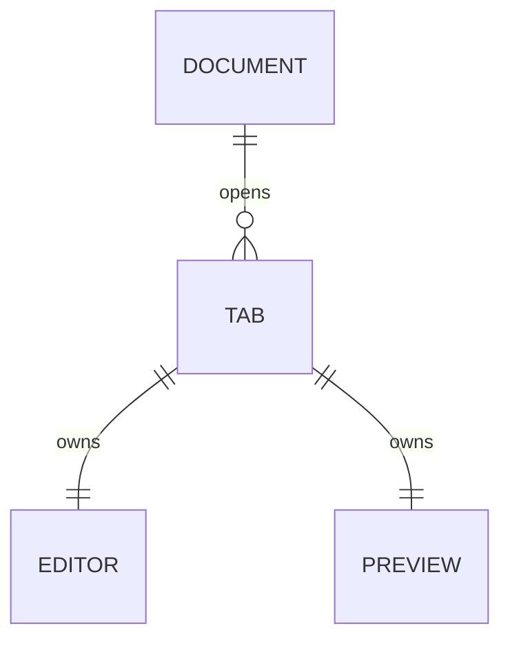

### Gantt chart

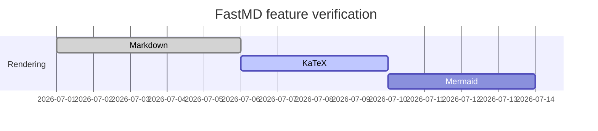

### Pie chart

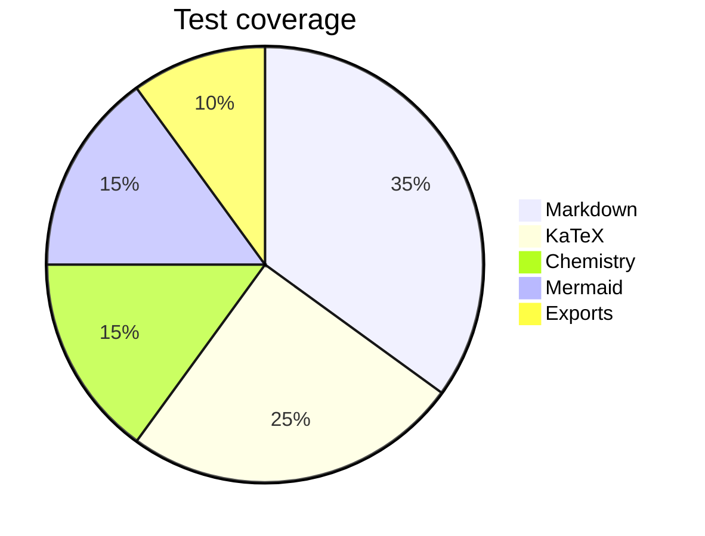

### Git graph

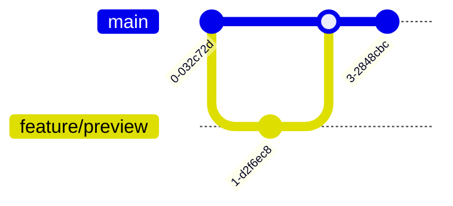

### Journey, mindmap, timeline, quadrant, and requirement diagrams

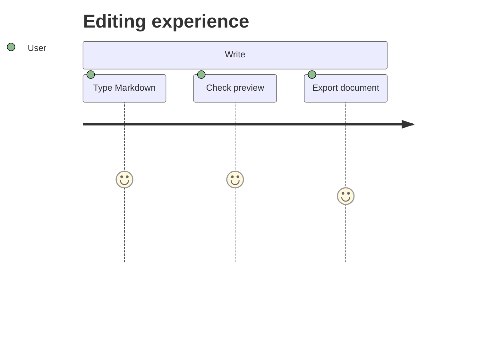

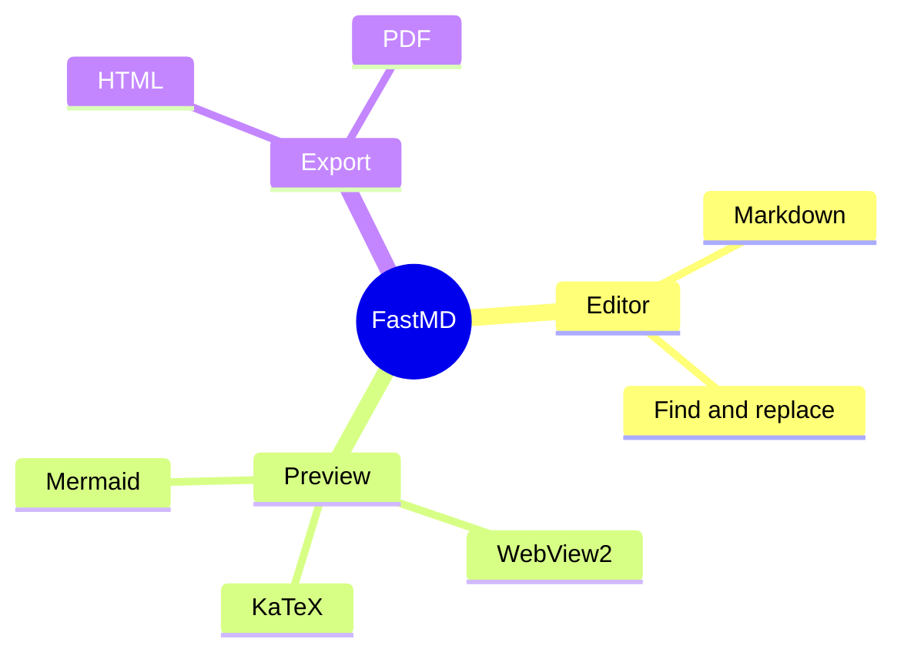

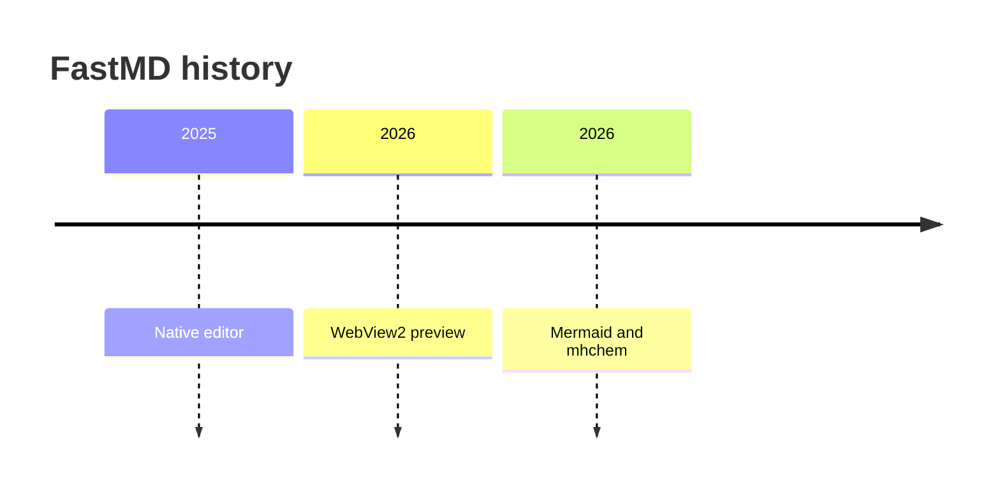

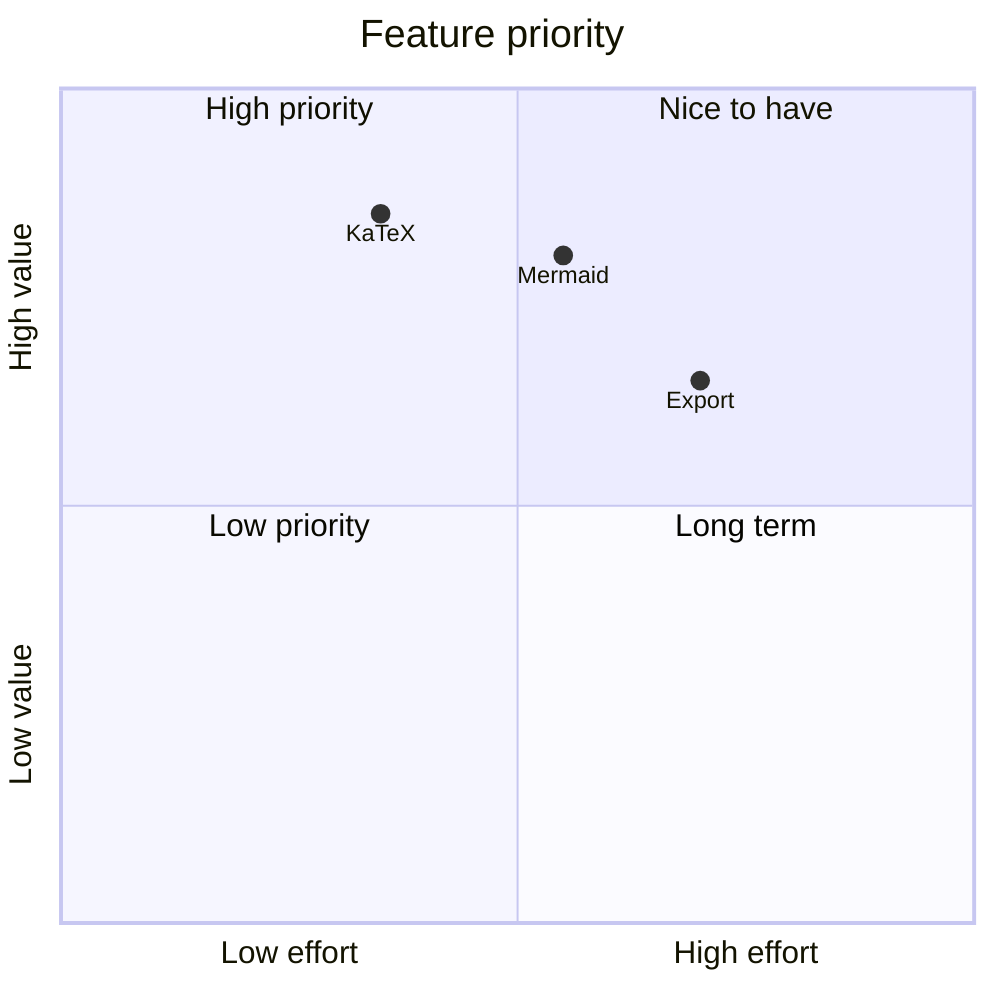

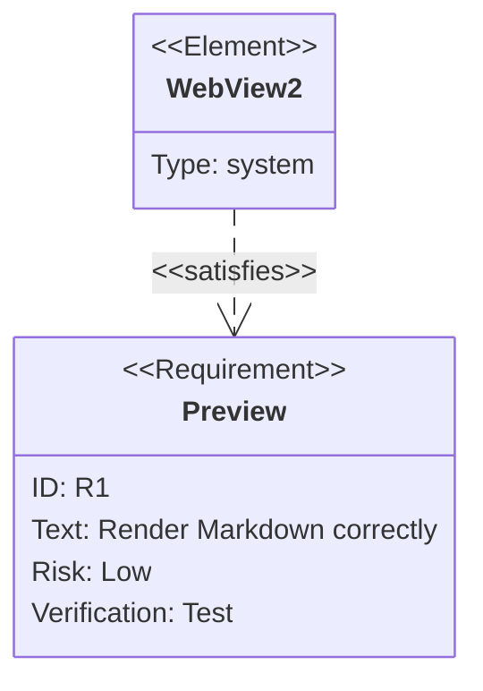

## Syntax-highlighted fenced code

```cpp
#include <iostream>

int main() {
    std::cout << "Hello, FastMD!" << std::endl;
    return 0;
}
```

```python
def fibonacci(n):
    a, b = 0, 1
    for _ in range(n):
        a, b = b, a + b
    return a
```

```javascript
const render = (markdown) => ({ html: markdown, ready: true });
console.log(render("FastMD"));
```

```json
{
  "name": "FastMD",
  "preview": "WebView2",
  "offline": true
}
```

```xml
<fastmd feature="syntax-highlighting">
  <language>markdown</language>
</fastmd>
```

```bash
cmake --build build --config Release
./FastMD.exe samples/test-all-features.md
```

```text
Plain fenced text should remain plain and preserve *literal Markdown*.
```

Tilde fences are supported too:

~~~sql
SELECT feature, supported FROM fastmd_features WHERE supported = 1;
~~~

## Page break

The following marker should create a page break in PDF/print output and a
visible separator in the live preview:

<div style="break-after: page;"></div>

## Mixed-content stress test

> [!TIP]
> A callout can contain math $\ce{H2O -> H+ + OH-}$, a task, and a table.
>
> - [ ] Verify the equation
> - [x] Verify the callout
>
> | Input | Output |
> |---|---|
> | `$x^2$` | KaTeX |
> | `flowchart LR` | Mermaid |

The final paragraph contains **all the small pieces**: :sparkles: `code`,
==mark==, H~2~O, x^2^, [a link](https://fastmd.app), and a footnote.[^final]

[^final]: Final mixed-content footnote. If this renders, the document is ready
    for a complete feature check.

---

End of FastMD feature test. ✅
